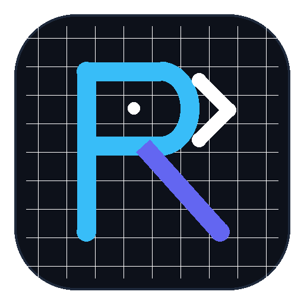
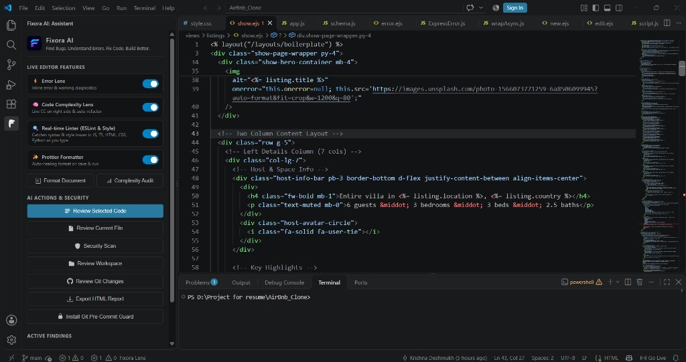
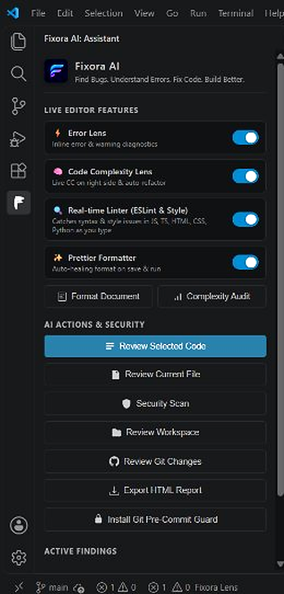
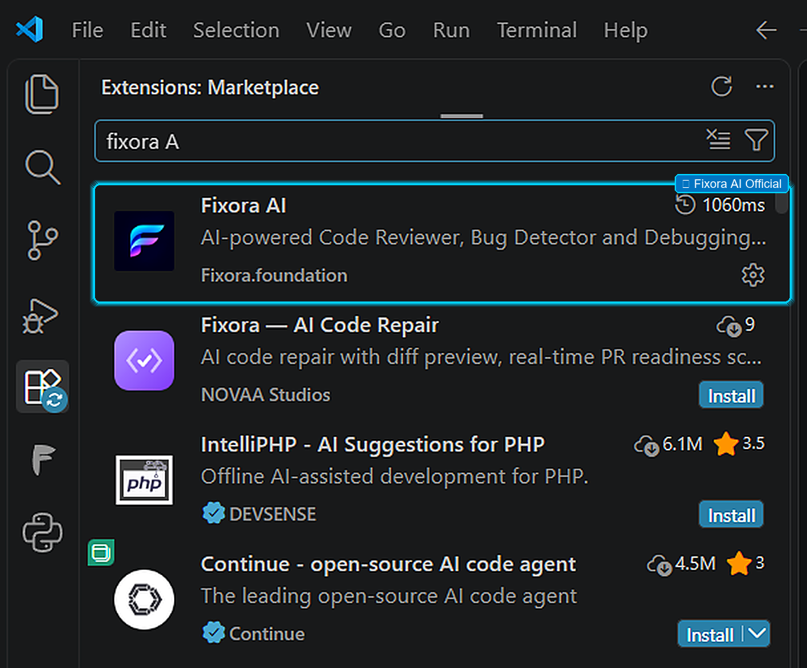

# Revion — Intelligent Code Review & Debugging

<p align="center">
  
</p>

<p align="center">
  <strong>Intelligent Code Review & Debugging Assistant</strong><br>
  <em>Find Bugs. Understand Errors. Fix Code. Build Better.</em>
</p>

<p align="center">
  <a href="https://marketplace.visualstudio.com/items?itemName=FixoraFoundation.fixora-ai"></a>
  <a href="https://marketplace.visualstudio.com/items?itemName=FixoraFoundation.fixora-ai"></a>
  <a href="https://github.com/krishna-Deshmukh13/Fixora-AI---Extension"></a>
  <a href="LICENSE"></a>
</p>

---

> ### 🚀 Available Now on the Visual Studio Code Marketplace!
> **Revion (published as Fixora AI) is officially live and available for free to developers worldwide.**  
> Install directly inside VS Code by searching for **`Revion`** or **`Fixora AI`** in your Extensions panel (`Ctrl + Shift + X`), or run:
> ```bash
> code --install-extension FixoraFoundation.fixora-ai
> ```
> 👉 **[View Live on VS Code Marketplace](https://marketplace.visualstudio.com/items?itemName=FixoraFoundation.fixora-ai)**

---

## 📸 Live Product Showcase

<div align="center">
  <h3>⚡ Revion Live In Action (Visual Studio Code)</h3>
  <p><em>Real-world demonstration inside a live full-stack codebase (<code>AirBnb_Clone</code>), featuring the unified Activity Bar control center, inline diagnostic decorations, and status bar monitor.</em></p>
  <a href="media/fixora-vscode-live-ui.png" target="_blank">
    
  </a>
  <p><sub><em>(Click any image to view in full 2K Ultra HD resolution)</em></sub></p>
</div>

<br>

<div align="center">
  <table width="100%" style="border-collapse: collapse; border: none;">
    <tr>
      <td width="36%" align="center" valign="top" style="padding: 10px; border: none;">
        <h4>🎛️ Unified Control Center</h4>
        <a href="media/fixora-sidebar-panel.png" target="_blank">
          
        </a>
        <br>
        <p align="left">
          <sub>
            <strong>Real-Time Feature Controls:</strong><br>
            • ⚡ <strong>Error Lens:</strong> Inline & gutter diagnostics<br>
            • 🧠 <strong>Complexity Lens:</strong> Cyclomatic CC badges<br>
            • 🔍 <strong>Real-Time Linter:</strong> Multi-lang AST checks<br>
            • ✨ <strong>Prettier Formatter:</strong> Silent auto-healing<br>
            • 🤖 <strong>AI Actions:</strong> 1-click code reviews & audits
          </sub>
        </p>
      </td>
      <td width="64%" align="center" valign="top" style="padding: 10px; border: none;">
        <h4>🔍 VS Code Marketplace Discoverability</h4>
        <a href="media/vscode-search-highlight.png" target="_blank">
          
        </a>
        <br>
        <p align="center">
          <sub><strong>Top Search Result:</strong> Live, verified, and installable directly inside VS Code under <code>FixoraFoundation.fixora-ai</code></sub>
        </p>
        <br>
        <h4>📊 Official Publisher Analytics</h4>
        <a href="media/marketplace-live.png" target="_blank">
          
        </a>
        <br>
        <p align="center">
          <sub><strong>Verified Publisher Dashboard:</strong> Active developer adoption and verified publishing pipeline.</sub>
        </p>
      </td>
    </tr>
  </table>
</div>

---

## 📌 Executive Summary

**Revion** is a production-grade developer tool for Visual Studio Code authored from scratch by **Krishna Deshmukh**. It eliminates the friction of juggling multiple separate extensions (Error Lens, ESLint, Prettier, CodeMetrics, and AI assistants) by unifying them into a single, cohesive, high-performance developer workspace.

Built with strict **TypeScript**, **VS Code Extension API**, and local AST parsing, Revion features **4 offline core engines** that run with zero internet latency, combined with context-aware AI code review powered by **Google Gemini** (Gemini 2.0 Flash) and local **Ollama** models.

---

## 🏗️ Architecture & Working Model

Revion operates through a responsive event-driven pipeline coordinating real-time editor events with static analysis and AI reasoning engines:


---

## 🌟 The 4 Built-In Powerhouses

### 1. ⚡ Native Error Lens (Inline Diagnostics)
- **Inline Message Rendering**: Renders errors, warnings, and hints directly at the end of the problematic line as you write code.
- **Line Highlighting**: Subtly illuminates line backgrounds based on diagnostic severity (Critical Red, Warning Yellow, Info Blue).
- **Status Bar Navigator**: Displays real-time error counts in the status bar with rapid navigation shortcuts:
  - `Alt + F8`: Jump to next error in file
  - `Shift + Alt + F8`: Jump to previous error in file
  - `Alt + E`: Toggle inline error lens on/off

### 2. 🧠 Code Complexity Lens & 1-Click Offline Refactoring
- **Right-Side Metrics Badges**: Automatically measures cyclomatic complexity (CC) and displays a color-coded rating on the right side of every function declaration:
  - `⚡ CC: 1-5 (Clean)` — Green
  - `⚡ CC: 6-10 (Moderate)` — Yellow
  - `⚡ CC: >10 (High Complexity)` — Red
- **Interactive Hover Cards**: Hovering reveals decision branch points, maintainability index, and a low-complexity alternative.
- **Instant Offline Refactoring (`Ctrl + .`)**: Press `Ctrl + .` on any complex function to select:
  > `💡 Revion: Replace with low-complexity alternative code (Offline Refactor: CC 14 ➔ 2)`  
  Replaces nested condition ladders with early exit guard clauses and $O(1)$ dictionary lookup tables completely offline.

### 3. 🔍 Real-Time Multi-Language Linter (As-You-Type)
Validates code on the fly without waiting for external server responses:
- **JavaScript & TypeScript**: Catches loose equalities (`eqeqeq`), obsolete `var` declarations (`no-var`), `debugger;` statements, `console.log` in production, condition assignment traps `if (x = 5)`, and unbalanced braces.
- **Python**: Catches missing colons `:` after statements, PEP 8 comparisons (`is None` vs `== None`, `== True`), and bare `except:` clauses.
- **HTML**: Detects missing `alt` attributes on `` tags, deprecated HTML5 tags (`<center>`, `<font>`, `<marquee>`), unclosed tags, and mismatched closing tags.
- **CSS / SCSS**: Catches missing semicolons, unnecessary zero units (`0px` $\rightarrow$ `0`), missing dimension units on non-zero lengths (`width: 200;`), and duplicate properties.
- **1-Click QuickFixes**: Every detected lint issue provides an automated quick fix via the VS Code lightbulb.

### 4. ✨ Prettier Formatter & Silent Syntax Auto-Healer
- **Integrated Prettier**: Native opinionated formatting for JS, TS, HTML, CSS, JSON, Markdown, and YAML.
- **Silent Syntax Healer**: Automatically auto-repairs missing braces, unclosed JSX/HTML tags, and trailing stray syntax upon save or run without interrupting the developer with modal error popups.

---

## 🤖 Context-Aware AI Review & Debugging

When you need high-level architectural insight, Revion taps into **Google Gemini** or local **Ollama**:
- **Selection & File Review**: Deep code audits highlighting security flaws, memory leaks, and performance bottlenecks.
- **OWASP Security Audit**: Scans for SQL injection, Cross-Site Scripting (XSS), command injection, and insecure deserialization.
- **7-Question Error Explanations**: Answers *What happened?*, *Why did it happen?*, *Where is it?*, *What is the root cause?*, and *How do I fix it?* with verified copyable code.
- **Atomic Diff Previews**: Inspect side-by-side visual diffs before applying any change. Fixes are applied cleanly through VS Code's `WorkspaceEdit` with zero full-file overwrites.
- **100% Client-Side Secret Redaction**: All API keys, passwords, and tokens are scrubbed locally into `[REDACTED_SECRET]` before hitting the network.

---

## 🎛️ Interactive Sidebar Dashboard

The activity bar panel provides a clean, distraction-free control center with tabbed navigation:

```
┌──────────────────────────────────────────────┐
│  Revion                               [⚙]    │
│  Assistant | Review | Issues | History       │
├──────────────────────────────────────────────┤
│  Live Editor Engines                         │
│  ⚡ Error Lens               [ ON  |  OFF ]   │
│  🧠 Code Complexity Lens     [ ON  |  OFF ]   │
│  🔍 Real-Time Linter         [ ON  |  OFF ]   │
│  ✨ Prettier Formatter       [ ON  |  OFF ]   │
├──────────────────────────────────────────────┤
│  Audits & Workflows                          │
│  • Review Selected Code                      │
│  • Review Current File                       │
│  • Security Audit (OWASP Top 10)             │
│  • Code Health Audit (Complexity & Dups)     │
│  • Review Workspace                          │
│  • Review Git Changes                        │
│  • Explain Terminal Error & Stack Trace      │
│  • Install Git Pre-Commit Guard              │
│  • Export HTML Audit Report                  │
└──────────────────────────────────────────────┘
```

---

## ⌨️ Command & Shortcut Reference

All commands are accessible from the Command Palette (`Ctrl + Shift + P`) under the **Revion** category:

| Command | Identifier | Shortcut |
| :--- | :--- | :--- |
| **Review Selected Code** | `fixora.reviewSelection` | `Ctrl+Alt+R` (`Cmd+Alt+R`) |
| **Explain Selected Error** | `fixora.explainError` | `Ctrl+Alt+E` (`Cmd+Alt+E`) |
| **Toggle Error Lens** | `fixora.toggleInlineDiagnostics` | `Alt+E` |
| **Jump to Next Diagnostic** | `fixora.nextDiagnostic` | `Alt+F8` |
| **Jump to Previous Diagnostic** | `fixora.previousDiagnostic` | `Shift+Alt+F8` |
| **Format Document** | `fixora.formatDocument` | `Shift+Alt+F` |
| **Format Selection** | `fixora.formatSelection` | `Ctrl+K Ctrl+F` |
| **Toggle Complexity Lens** | `fixora.toggleComplexityLens` | — |
| **Toggle Real-time Linter** | `fixora.toggleLinter` | — |
| **Toggle Prettier Formatter** | `fixora.toggleFormatter` | — |
| **Security Audit** | `fixora.securityScan` | — |
| **Review Active File** | `fixora.reviewFile` | — |
| **Review Workspace** | `fixora.reviewWorkspace` | — |
| **Review Git Changes** | `fixora.reviewGit` | — |
| **Code Health Audit** | `fixora.qualityReview` | — |
| **Explain Terminal Error** | `fixora.explainTerminal` | — |
| **Export HTML Report** | `fixora.exportReport` | — |
| **Install Pre-Commit Hook** | `fixora.installGitHook` | — |

---

## 🧪 Rigorous Quality & Verification

Revion has been built and tested with industry-standard test-driven engineering:
- **34 Comprehensive Test Suites**
- **174 Passing Unit Tests** with 100% pass rate
- **Zero-Dependency VSIX Packaging**: Bundled via Esbuild into an ultra-lean binary (~3.6 MB with zero sourcemap leakage).

To run the test suite locally:
```bash
npm install
npm run compile
npm test
```

---

## 👨‍💻 Developer & Author

- **Author**: Krishna Deshmukh
- **Publisher**: `FixoraFoundation` (Marketplace: `Fixora.foundation`)
- **Email**: [krishnadeshmukh721@gmail.com](mailto:krishnadeshmukh721@gmail.com)
- **LinkedIn**: [https://www.linkedin.com/in/krishnadeshmukh13](https://www.linkedin.com/in/krishnadeshmukh13)
- **Repository**: [https://github.com/krishna-Deshmukh13/Fixora-AI---Extension](https://github.com/krishna-Deshmukh13/Fixora-AI---Extension)

---

## 📄 License

Revion is open-source software licensed under the [MIT License](LICENSE).
